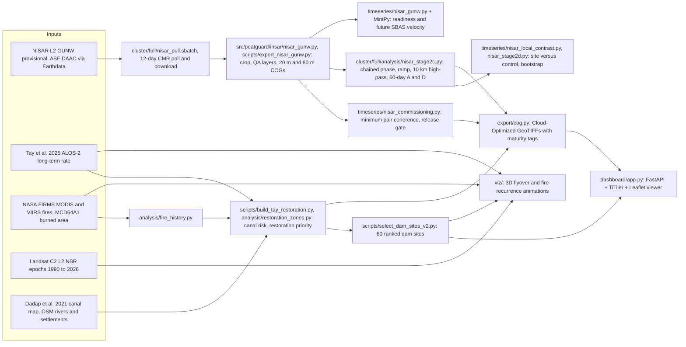

# PeatGuard NISAR

NISAR L-band radar over drained tropical peat, turned into a ranked list of
canal-blocking dam sites for village crews in Central Kalimantan, Indonesia.

Submission for the NASA Space Apps Challenge 2026, "Dancing with the SARs".
Open source under the MIT licence.

## What it does

PeatGuard ingests NASA/ISRO NISAR L2 GUNW interferograms (12-day repeat,
L-band, 24 cm wavelength) over the Sebangau and former Mega Rice Project
peatlands (114.21 to 114.83 E, 3.00 to 2.42 S), and produces:

1. **12-day interferometric coherence** on the native 20 m GUNW grid, as the
   minimum over every retained pair in the chain. This is the layer that shows
   where L-band keeps seeing the peat surface through the canopy and the wet
   season, and where it does not.
2. **60-day relative line-of-sight displacement** on both the ascending and
   the descending track, after per-pair ramp removal and a 10 km spatial
   high-pass, as a site-versus-control pattern diagnostic (not a rate).
3. A **restoration-priority surface** that fuses the independent Tay et al.
   2025 ALOS-2 subsidence benchmark with canal proximity (Dadap et al. 2021)
   and MODIS/VIIRS fire history, and ranks 60 canal-blocking dam sites.
4. An **interactive map viewer** (FastAPI + TiTiler + Leaflet) that serves all
   of the above as Cloud-Optimized GeoTIFF tiles with legends, maturity
   labels and pixel queries, and runs on the sample data in this repository.
5. The **figure and animation code** behind the demo videos: a 3D flyover of
   36 years of degradation and fire, and the "fire keeps returning to the
   same drained peat" recurrence animation.

The physical story and hypotheses: drainage canals dug for the 1996 Mega Rice
Project lowered the water table, the peat oxidises and compacts (subsidence,
Hooijer et al. 2012 [E]), dried peat burns and re-burns in El Nino years, and
blocking the canals is the cheapest intervention. Radar subsidence is the
observable that tracks the oxidation term, and L-band is the only band that
reaches the ground here. The hypothesis the NISAR time series will test over
the coming year is that subsidence rates fall measurably downstream of the
dams that crews build [H].

## Honest status

Everything below follows the project audit trail in `docs/scientific_audit/`.
Confidence tags: [E] established, [S] standard inference, [H] hypothesis.

- **C-band cannot measure peat subsidence here** [E]. A full Sentinel-1
  ISCE2 topsStack + MintPy SBAS run (45 dates, 249 interferograms) gives a
  velocity field with Pearson r of about -0.03 against the Tay et al. 2025
  ALOS-2 benchmark over 169,000 pixels, with mean spatial coherence 0.31. A
  faithful reproduction of the Umarhadi and Siegert 2026 Block B (47 dates,
  255 interferograms) is more coherent (0.55) but still r of about -0.04,
  because the signal (about 9.6 mm/yr) is below the C-band noise (about
  22.5 mm/yr). The published 1 cm RMSE in that paper is an internal
  cross-validation, not an independent L-band check.
- **NISAR detects the ground at 12 days** [E]. Minimum pair coherence over
  the four-pair 4 Jul to 14 Sep 2026 chain clears the 0.5 commissioning
  threshold over most of the drained peat; the two tracks agree on where
  coherence holds. The coherence layers are released with the mission's
  PROVISIONAL maturity.
- **No NISAR subsidence rate yet** [E]. The 60-day relative displacement
  fails the release gate: no mineral-ground reference within 60 km, per-pair
  residual of +-20 to 40 mm that flips sign between pairs, and GUNW phase
  that still contains ionosphere. Sustained rates need a year or more of
  12-day data, a bandwidth-20 network, closure-phase bias correction and a
  GNSS-controlled datum. The displacement layers in this repository are
  labelled EXPERIMENTAL and are pattern diagnostics, not rates.
- **No ground truth yet**. There are no dipwell, levelling or GNSS
  measurements of our own; validation is against the independent satellite
  benchmark only (TRL 4). The benchmark is never used to calibrate or fit our
  estimates.
- **Nothing here is a water-table proxy**. InSAR measures surface motion.
  The link from subsidence to drainage and carbon loss is Hooijer et al.
  2012 [E]; any water-table inference from our products would be [H].
- **Method attribution**. The SBAS + machine-learning gap-fill approach we
  model is Umarhadi and Siegert 2026; the L-band processing recipe and the
  independent rate benchmark are Tay et al. 2025; the canal map is Dadap et
  al. 2021; burn-index thresholds follow Key and Benson 2006. No part of the
  method is attributable to any other individual researcher.

## Architecture



## Quick start

Requirements: Python 3.10 or newer with GDAL-backed rasterio (conda-forge or
system GDAL), and about 200 MB of disk.

```bash
git clone <this repository> peatguard-nisar
cd peatguard-nisar
python3 -m venv .venv && source .venv/bin/activate
make install          # pip install -e '.[ci,dashboard]'
make demo             # viewer on http://localhost:8080 using data/sample/
```

`make demo` starts the TiTiler viewer with `PEATGUARD_WEBDATA_DIR=data/sample`.
Open http://localhost:8080/, toggle the NISAR coherence, 60-day displacement,
Tay subsidence, fire history and restoration-priority layers, and click a
pixel for its value. Endpoints: `/api/products` (catalogue with maturity
metadata), `/cog/tiles/WebMercatorQuad/{z}/{x}/{y}.png?url=...`,
`/cog/point/{lon},{lat}?url=...`, `/health`. The viewer only serves rasters
inside the configured data directory.

Docker: `docker compose up dashboard` builds `Dockerfile.dashboard` and mounts
`data/sample`.

Tests (offline, no satellite data needed): `make test`.

## Pulling NISAR GUNW from ASF

1. Create a NASA Earthdata account and put the credentials in `~/.netrc`
   (`machine urs.earthdata.nasa.gov login <user> password <pass>`). Nothing in
   this repository stores credentials.
2. Find granules over the AOI. The provisional GUNW collection is
   `C2854335566-ASF`; `cluster/full/nisar_pull.sbatch` shows the CMR query
   (`point=113.95,-2.85`), and `asf_search` works too:
   ```python
   import asf_search as asf
   results = asf.search(platform="NISAR", processingLevel="GUNW",
                        intersectsWith="POLYGON((114.21 -3.0,114.83 -3.0,114.83 -2.42,114.21 -2.42,114.21 -3.0))")
   results.download(path="gunw/", session=asf.ASFSession().auth_with_creds(user, password))
   ```
3. Export the transparent QA layers (coherence, unwrapped phase, connected
   components, ionosphere screen) cropped to the AOI at 20 m and 80 m:
   ```bash
   python scripts/export_nisar_gunw.py gunw/NISAR_L2_GUNW_....h5 --output-dir out/gunw_qa \
       --bbox 114.21 -3.0 114.83 -2.42
   ```
   No atmospheric correction or velocity conversion happens here.
4. Audit the commissioning chain and release gate:
   `python scripts/audit_nisar_commissioning.py --help`, and the local
   site-versus-control diagnostic
   `python scripts/audit_nisar_local_contrasts.py --help`.
5. Prepare a MintPy stack from the GUNW variants when enough dates exist:
   `python scripts/prepare_nisar_gunw_timeseries.py --help`
   (`config/nisar.yaml` holds the L-band parameters; the Dockerfile pins the
   MintPy revision with native NISAR GUNW loading).

The forward-processing loop on the Slurm cluster (`cluster/full/`) re-polls
CMR every 12 days, downloads new granules and reruns the coherence and
contrast stages into a dated directory. It needs ISCE2, MintPy and a cluster
account; it is not required to run the viewer.

## Reproducing each figure

| Figure or video | Command | Inputs |
| --- | --- | --- |
| Minimum pair coherence (20 m, 80 m) | `python scripts/audit_nisar_commissioning.py` on the exported GUNW QA layers | GUNW granules from ASF |
| 60-day displacement A and D, site versus control | `cluster/full/analysis/nisar_stage2c.py` then `nisar_stage2d.py` (Slurm, see `cluster/full/README.md`) | GUNW chain, Tay stable-ground mask, dam sites |
| Restoration priority and canal risk | `python scripts/build_tay_restoration.py --help` | Tay 2025 raster, canal mask, fire history |
| Dam-site ranking | `python scripts/select_dam_sites_v2.py --help` | canal centrelines, restoration priority |
| 3D flyover 1990 to 2026 | `DATA_ROOT=... python viz/aoi_3d_degradation/render.py --all && python viz/aoi_3d_degradation/assemble.py` | prepared work-grid layers (see `viz/README.md`) |
| Degradation-then-fire two-act cut | `DATA_ROOT=... python viz/aoi_3d_degradation/cut_two_act.py` | same |
| Fire recurrence maps, chart and animation | `DATA_ROOT=... python viz/degraded_peat_fire_recurrence/build.py` | FIRMS archive, PeatGrids, work-grid layers |
| Sentinel-1 negative result (C-band versus Tay) | `python scripts/subsidence_ml_s1.py --help`, `scripts/audit_alternate_baselines.py` | S1 SBAS products (not included) |

Demo videos (rendered from `viz/`, kept outside the repository because of
size; ask the team for links):

- `PeatGuard_AOI_3D_degradation_1990_2026.mp4` and `_SLIDE.mp4`
- `PeatGuard_AOI_3D_degradation_then_fire_SLIDE.mp4` and `_LAND_ONLY.mp4`
- `PeatGuard_AOI_3D_fires_yearly_1990_2026_SLIDE.mp4`, `_SLIDE_v4.mp4`, `_LAND_ONLY.mp4`
- `PeatGuard_AOI_3D_fire_proof_2015.mp4`
- `fires_return_to_degraded_peat_2001_2026.mp4` and `_SLIDE.mp4`

## Repository layout

```
src/peatguard/        pipeline package: ingest, insar (ISCE2 topsApp/stripmapApp, NISAR GUNW and GSLC),
                      timeseries (MintPy prep, commissioning gate, local contrasts), analysis, export, dashboard
scripts/              command-line entry points for every stage and audit
cluster/              Slurm jobs and analysis for the ALOS-2 baseline campaign and the NISAR 12-day pull
config/               default.yaml, nisar.yaml (L-band overrides), kapuas.yaml
tests/, cluster/full/tests/   offline regression suite (330 tests)
docs/                 integration plan, scientific audits, release decisions, legacy GCP files
viz/                  figure and animation code (3D flyover, fire recurrence)
data/sample/          7 small COGs with provenance in DATA.md
```

## References

- Tay, C. et al. (2025). Satellite radar advances carbon emissions
  accountability over tropical peat. Communications Earth & Environment.
  ALOS-2 L-band long-term subsidence rate, 12 Oct 2018 to 9 Aug 2024, used as
  the independent benchmark [E].
- Umarhadi, D. A. and Siegert, F. (2026). Monitoring degraded tropical
  peatland subsidence by integrating SBAS InSAR and machine learning.
  Environmental Research Communications. doi:10.1088/2515-7620/ae43ab. The
  SBAS + ML approach we model [E].
- Hooijer, A. et al. (2012). Subsidence and carbon loss in drained tropical
  peatlands. Biogeosciences 9, 1053 to 1071. Subsidence to carbon-loss and
  drainage-risk basis [E].
- Dadap, N. C. et al. (2021). Drainage canals in Southeast Asian peatlands
  increase carbon emissions. AGU Advances 2, e2020AV000321. Canal map [E].
- Key, C. H. and Benson, N. C. (2006). Landscape Assessment (LA), in FIREMON:
  Fire Effects Monitoring and Inventory System. USDA Forest Service
  RMRS-GTR-164-CD. NBR burn-severity thresholds [E for the index, S for our
  thresholds].
- NASA/ISRO NISAR L2 GUNW provisional products, ASF DAAC. NASA FIRMS.
  USGS Landsat Collection 2.

## Team

PeatGuard, a Singapore and Indonesia team:

- Tommy Quak, Technology and Geospatial Lead (satellite and remote-sensing
  engineer, National University of Singapore); author of this code.
- Delfina Poernomo, Community and Partnerships Lead, Indonesia.
- Louise Goh, Strategy and Partnerships Lead, Singapore.
- Chia Jia Yuun, Carbon and Sustainability Analytics Lead.

PeatGuard placed third in the Adaptation and Resilience track of the Global
Sustainability Challenge 2026 and is part of the Stanford EcoGlobal Program.

## Licence

MIT, Copyright (c) 2026 Tommy Quak. See `LICENSE`. Third-party data keep
their own terms (see `data/sample/DATA.md`). Please cite via `CITATION.cff`.
